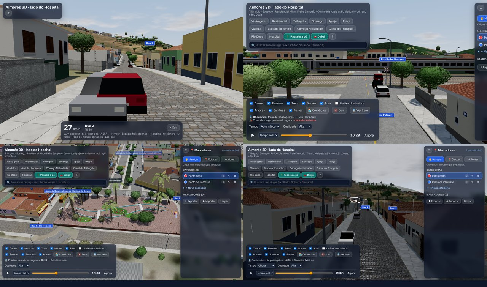

# aimores-3d

Aimorés 3D – maquete interativa da cidade (lado do Hospital: Triângulo, Sossego, Residencial Nilton Freire Sampaio, Centro, córrego e Rio Doce).

Site: abra `index.html` por um servidor (GitHub Pages). Não funciona abrindo o arquivo direto do disco (`file://`), porque os dados são baixados com `fetch`.


## O que tem na v5

- **Mais leve**: download de ~5,5 MB (v4) para ~2,8 MB na qualidade Alta e ~2 MB na Leve; cena com ~1,4 milhão de triângulos na Alta (v4: 3–4 milhões) e ~0,7 milhão na Leve.
- **Casas alinhadas**: cantos retos, paralelas à rua, recuo uniforme em cada quadra, sem casas sobrepostas.
- **Ruas**: paralelepípedo de granito, asfalto, terra, calçadas, meio-fio, faixas pintadas e faixas de pedestre no Centro.
- **Trânsito**: hatch, sedã, SUV, picape, moto, ônibus e caminhão, na mão direita, com carros estacionados; faróis à noite.
- **Dia e noite**: sol e lua na posição real para Aimorés, estrelas; relógio no horário de Brasília. Os **postes acendem ao anoitecer** e apagam de manhã, janelas acendem à noite.
- **Córrego** do Triângulo/Centro até o Rio Doce, com leito, margens, mata ciliar, canal de concreto e galerias sob as ruas.
- **Rio Doce e lago da represa** com reflexo do céu e ondulação.
- **Árvores** por espécie (mangueira, oiti, coqueiro, palmeira, ipê, flamboyant, eucalipto, mata).
- **Viadutos** com asfalto novo e postes.

## Novidades da v6



- **🚶 Passeio a pé e 🚗 Dirigir**: andar pela cidade em primeira pessoa (com colisão em casas e muros) ou dirigir um carro (freio de mão, buzina, faróis, 3 câmeras, motor, quebra-molas sentidos na suspensão).
- **Trem da Vale com horário**: passageiros às 10h29 (sentido BH) e ~16h59 (sentido Vitória), parando na estação; minério e carga ao longo do dia. Cancelas na Rua Antônio Polastri descem, o sinal toca, os carros esperam; buzina e barulho das rodas.
- **Comércios reais** (aba 🏪): 182 estabelecimentos (Overture Maps) com categoria, endereço e telefone; letreiros com os nomes reais nas fachadas; busca de ruas e lugares; nomes das ruas em placas.
- **Casas variadas**: atlas de fachadas, estilos (simples, padrão, moderna com platibanda, antiga, comércio, galpão), varandas, sacadas, garagens, caixas d'água, toldos.
- **Igreja Matriz, estação e Praça João Pinheiro** refeitas pelas fotos.
- **Córrego da Natividade** (OSM/ANA) e canal do Triângulo; relevo corrigido com Copernicus GLO-30.
- **Pedestres** nas calçadas movimentadas, conforme a hora; **tempo** (sol, nublado, chuva, neblina); **sons** sintetizados.
- **Quebra-molas** padrão CONTRAN em frente a escolas, igrejas, hospital e clínicas (posição aproximada — ajuste em `source/quebra_molas.json`).

## Estrutura

| Pasta / arquivo | O que é |
|---|---|
| `index.html`, `app.js` | o site pronto (gerados pelo build — não editar à mão) |
| `data/` | dados que o navegador baixa: `city.json` (casas, ruas, árvores, córrego…), `geo.bin.gz` (relevo + malhas das ruas + máscara de água), texturas de satélite em WebP (4k para qualidade alta, 2k para leve) |
| `src/` | código-fonte do app (ES modules + three.js) |
| `src/legacy/legacy.js` | construtores feitos à mão na v4 (igreja, praça, clube, estação, viadutos, marcadores…) extraídos do app antigo; vão sendo substituídos aos poucos |
| `source/` | dados brutos (entrada do pipeline) |
| `tools/` | scripts: pipeline de dados, análise do córrego, build |

## Como gerar

```bash
npm install
npm run data     # source/ -> data/  (alinha casas, processa córrego, água, texturas)
npm run build    # src/ -> app.js + index.html
```

`python3 tools/fetch-overture.py places/place base/water transportation/segment` baixa comércios, córregos e nomes de ruas (Overture Maps); `python3 tools/terrain-merge.py` aplica o relevo Copernicus (`source/copernicus_utm24s_30m.tif`).

`python3 tools/creek-trace.py` refaz a análise de drenagem que encontrou o córrego (gera `source/creek_raw.json`); o ajuste manual do trecho do Triângulo fica em `source/creek_fix.json`.

Parâmetros de URL úteis: `?q=low|medium|high|ultra` (qualidade), `?h=19.5` (horário), `?tempo=chuva|neblina|nublado|sol`, `?view=corrego|canal|praca|igreja|viadutocentro`, `?fps` (mostra FPS).
